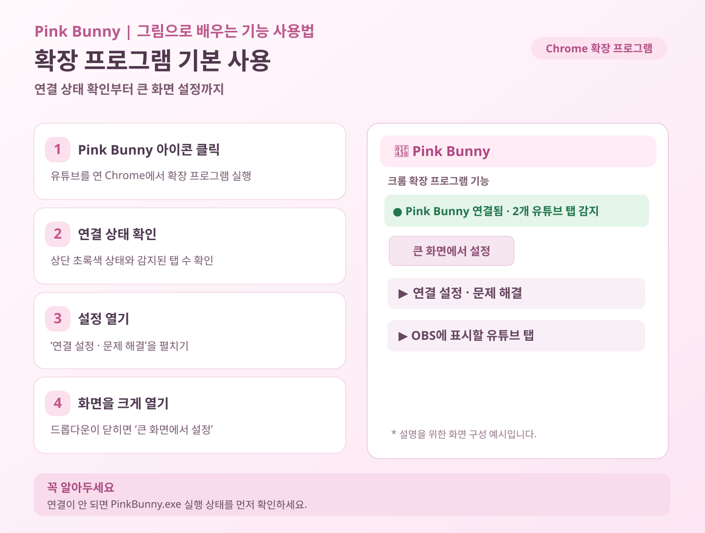
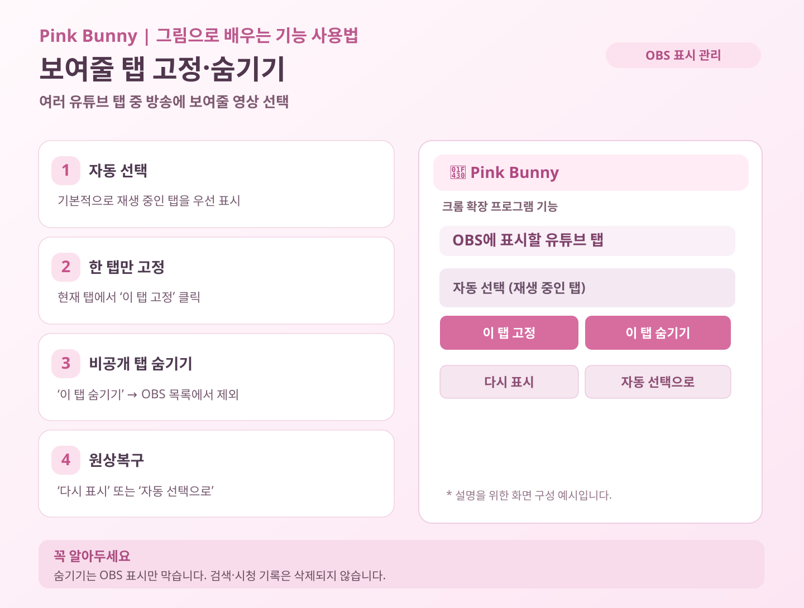
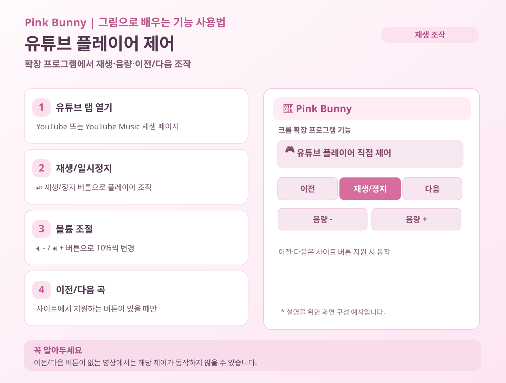
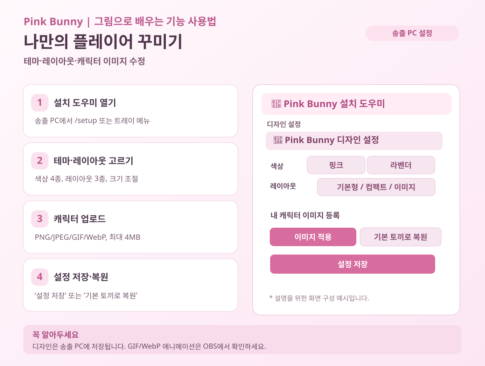
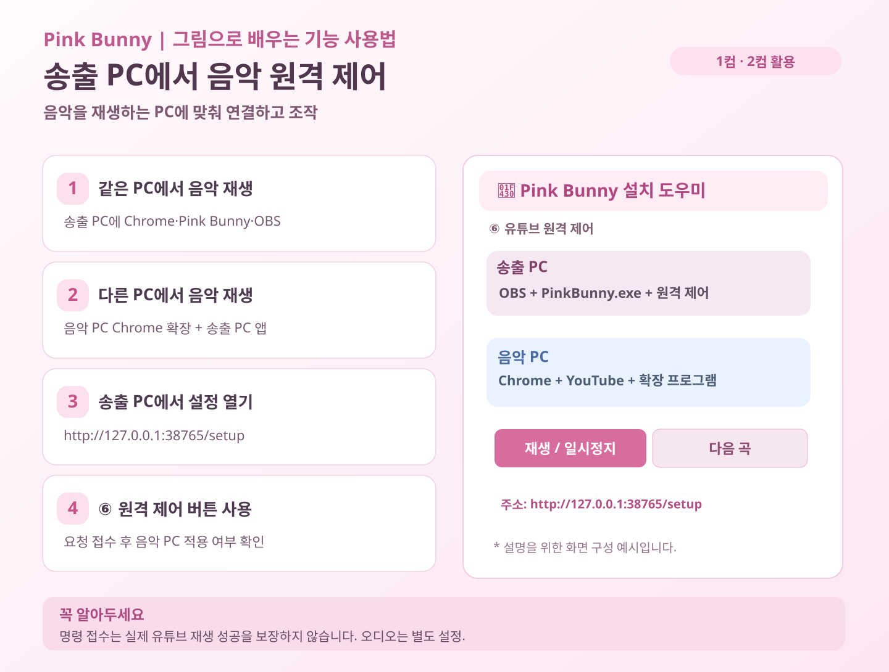
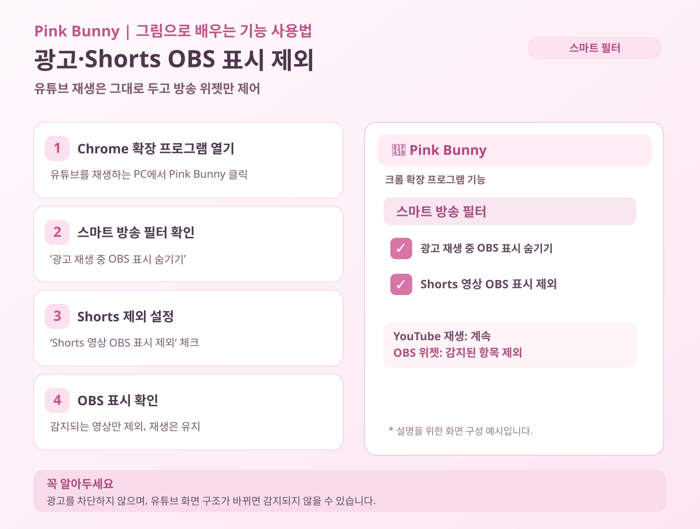
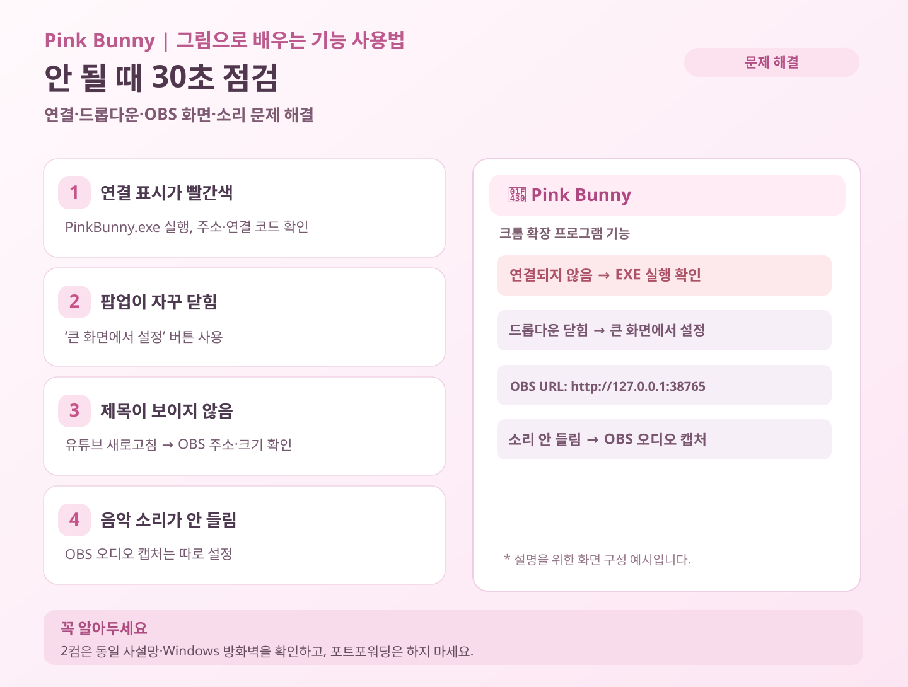

# 🐰 Pink Bunny 기능 사용 가이드

이 문서는 **설치가 끝난 사용자**가 기능을 찾아 쓰기 위한 한국어 안내입니다. [그림으로 보는 전체 안내서](GUIDE.md#features)에는 기능별 이미지 7장과 버튼 설명이 있습니다.

## 시작 전에 알아두기

- Pink Bunny는 YouTube / YouTube Music의 **현재 영상 정보**를 OBS에 표시하는 Windows 프로그램입니다.
- OBS와 PinkBunny.exe는 **송출 PC**에서 실행합니다. Chrome 확장 프로그램은 **유튜브를 재생하는 PC**에 설치합니다.
- 방송이 2컴이어도 송출 PC에서 음악을 재생한다면 **같은 PC 자동 연결 방식**을 사용합니다.
- 음악 소리 자체는 Pink Bunny가 전송하지 않습니다. OBS의 별도 오디오 설정이 필요합니다.

## 1. Chrome 확장 프로그램 기본 조작

1. 음악을 재생하는 PC의 Chrome에서 유튜브 탭을 엽니다.
2. Chrome 툴바에서 **Pink Bunny** 확장 프로그램을 클릭합니다.
3. 상단 **Pink Bunny 연결됨** 표시와 감지된 탭 개수를 확인합니다.
4. 연결되지 않으면 **연결 설정 · 문제 해결**을 펼치고 **1컴 자동 연결** 또는 **2컴 연결 주소 적용 (권한 허용)**을 사용합니다. 2컴에서는 Chrome이 요청하는 송출 PC 주소 접근 권한을 허용해 주세요.
5. 드롭다운을 선택하려다가 창이 닫히면 상단 **↗ 큰 화면에서 설정**을 누르세요. 별도 Chrome 탭에서 설정할 수 있습니다.

**그림:** [확장 프로그램 기본 사용](overlay/guide-feature-extension.svg)

## 2. OBS에 표시할 유튜브 탭 고정·숨김

- **자동 선택:** 재생 중인 유튜브 탭을 우선 표시합니다.
- **현재 탭 고정:** 해당 유튜브 탭을 활성화한 후 확장 프로그램에서 **📌 이 탭 고정**을 누르거나, **OBS에 표시할 유튜브 탭** 드롭다운에서 탭 선택 → **표시 탭 적용**을 누르세요.
- **현재 탭 숨김:** **🙈 이 탭 숨기기**를 누르면 해당 탭을 OBS 표시 후보에서 제외합니다.
- **다시 표시:** **👁️ 다시 표시**를 누릅니다.
- **고정 해제:** **자동 선택으로** 버튼을 누릅니다.

숨김은 OBS에 정보를 보여주지 않는 설정일 뿐 **브라우저 방문·시청 기록을 삭제하지 않으며 보안 차단 기능도 아닙니다.** 프로그램 재시작 또는 탭 닫기 시 숨김 설정이 유지되지 않을 수 있습니다.

**그림:** [탭 고정·숨김](overlay/guide-feature-tabs.svg)

## 3. 재생·일시정지, 이전·다음, 음량 조절

Chrome 확장 프로그램의 **🎮 유튜브 플레이어 직접 제어**에서 사용할 수 있습니다.

| 버튼 | 동작 |
| --- | --- |
| ⏯ 재생/정지 | 해당 탭의 영상 재생 또는 일시정지 요청 |
| ⏮ 이전 | 유튜브에 이전 버튼이 있을 때 선택 |
| 다음 ⏭ | 유튜브에 다음 버튼이 있을 때 선택 |
| 🔉 - | 해당 유튜브 영상 음량 약 10%포인트 감소(최소 0%) |
| 🔊 + | 해당 유튜브 영상 음량 약 10%포인트 증가(최대 100%, 음소거 중이라면 해제) |

**주의:** 이전·다음은 현재 유튜브 화면의 해당 버튼을 누르는 기능입니다. **일반 YouTube는 링크 형태의 다음/이전 버튼도 지원하도록 v12.0.3에서 수정했습니다.** 버튼이 아예 없거나 비활성화된 경우에는 작동하지 않으며, 버튼 클릭 후 실제 영상 전환 여부는 사이트에서 확인해야 합니다. **유튜브 영상 음량만 변경하며 Windows·OBS 오디오 믹서의 음량은 변경하지 않습니다.** Chrome·YouTube의 자동재생 제한도 영향을 줄 수 있습니다.

**버튼을 눌렀는데 아무 반응이 없을 때:** v12.0.2부터는 확장 프로그램이 이미 열린 YouTube 탭과 통신하지 못하면 제어 스크립트를 자동으로 연결하고 명령을 한 번 재시도합니다. 다만 브라우저의 사이트 액세스 권한을 제한한 경우에는 `chrome://extensions` → Pink Bunny → 사이트 액세스에서 YouTube/YouTube Music 사용을 허용해야 합니다. 확장 프로그램의 재생 버튼 바로 아래 메시지를 확인하세요. 통신 실패·버튼 없음·최대/최소 음량 여부를 표시합니다. `chrome://extensions`에서 확장 프로그램을 새로고침하고 유튜브 페이지도 새로고침해 보세요. 기본 팝업은 현재 유튜브 탭을, 큰 화면 설정은 선택한 유튜브 탭을 우선 제어합니다.

**그림:** [재생 제어](overlay/guide-feature-controls.svg)

## 4. 플레이어 디자인·캐릭터 꾸미기

1. **송출 PC**에서 `http://127.0.0.1:38765/setup`을 엽니다.
2. **🎨 Pink Bunny 디자인 설정**에서 핑크·라벤더·민트·피치 테마와 레이아웃(기본형·컴팩트·이미지 강조형)을 선택합니다.
3. 배경 불투명도 **20~100%**, 플레이어 크기 **75~100%**를 조절합니다.
4. **내 캐릭터 이미지 등록**에서 PNG/JPEG/GIF/WebP 파일을 선택하고 **이미지 적용**을 누릅니다. 파일은 **4MB 이하**, 각 변은 **2048px 이하**여야 합니다.
5. 캐릭터 크기 **50~200%**, 상하·좌우 위치 **-40~40px**를 조절한 뒤 **설정 저장**을 누릅니다.
6. 사용자 이미지를 제거하고 싶다면 **기본 토끼로 복원**을 선택합니다.

움직이는 GIF/WebP는 OBS 브라우저 소스에서 실제로 재생되는지 확인해 주세요. 디자인 설정과 사용자 이미지 파일은 **송출 PC**에 저장됩니다.

**그림:** [디자인·캐릭터 꾸미기](overlay/guide-feature-design.svg)

## 5. 1컴·2컴과 송출 PC 원격 제어

- **유튜브를 송출 PC에서 재생:** 송출 PC에 Pink Bunny·OBS·Chrome 확장 프로그램을 모두 두고 **1컴 자동 연결**을 사용합니다. 게임컴이 따로 있어도 가능합니다.
- **유튜브를 다른 PC에서 재생:** 송출 PC에는 Pink Bunny와 OBS를 두고, 음악 PC의 Chrome 확장 프로그램을 **2컴 연결 주소**로 연결합니다.
- 원격 제어는 **송출 PC**의 `http://127.0.0.1:38765/setup` → **⑥ 유튜브 원격 제어**에서 사용할 수 있습니다.
- v12부터는 송출 PC에서 명령을 보내면 **대기 중·전달됨·Chrome에서 명령 처리 성공/실패·시간 초과**를 구분하여 보여줍니다. **처리 성공은 실제 OBS 오디오 수신을 보증하지 않으므로** 음악 PC 화면도 확인하세요.

두 PC는 신뢰할 수 있는 사설망에서 사용해야 하고, 연결 주소에 들어 있는 코드를 공개적으로 공유하거나 인터넷 포트포워딩을 하면 안 됩니다.

**그림:** [1컴·2컴 활용](overlay/guide-feature-remote.svg)

## 6. 광고·Shorts 스마트 방송 필터

1. 음악 PC의 Chrome에서 Pink Bunny 확장 프로그램을 엽니다.
2. **🛡️ 스마트 방송 필터**에서 **광고 재생 중 OBS 표시 숨기기**와 **Shorts 영상 OBS 표시 제외**를 선택합니다.
3. 설정은 Chrome 확장 프로그램의 로컬 저장소에 보관됩니다.

**이 기능은 광고 차단이 아닙니다.** 감지 가능한 광고·Shorts 정보를 OBS 표시에서 제외하는 기능이며, YouTube 화면 구조 변경이나 광고 유형에 따라 감지가 안 될 수 있습니다. 유튜브 재생 자체는 중단시키지 않습니다.

**그림:** [스마트 방송 필터](overlay/guide-feature-filters.svg)

## 방송 시작 전에 자동 진단하기 (v12)

송출 PC에서 `http://127.0.0.1:38765/setup`을 열면 **🩺 방송 준비 자동 진단**이 표시됩니다. 서버 정상 응답, 최근 12초 이내 Chrome 확장 프로그램 요청, 최근 YouTube 영상 정보 수신은 자동으로 점검합니다. 통신 정보가 없으면 ‘확인 필요’로 표시하며 확장 프로그램 미설치로 단정하지 않습니다.

**OBS 브라우저 소스 및 방송 음악 오디오는 자동으로 확인되지 않습니다.** 진단 화면의 안내에 따라 OBS에서 수동으로 점검하세요. 자동 진단이 모든 항목을 ‘정상’으로 표시하더라도 실제 송출 화면·오디오 확인은 별도로 필요합니다.

## 7. 자주 발생하는 문제 해결

| 증상 | 먼저 확인할 것 |
| --- | --- |
| 연결 상태 빨간색/오류 | PinkBunny.exe 실행 여부, Chrome 확장 연결 주소, 2컴 코드·방화벽 |
| 탭 드롭다운 클릭 시 창 닫힘 | 확장 프로그램의 **↗ 큰 화면에서 설정** 사용 |
| 제목·썸네일 표시 안 됨 | YouTube 탭 새로고침, 탭 고정·숨김 설정, 광고 필터, Chrome 확장 연결 |
| OBS 화면 안 보임 | 송출 PC OBS 브라우저 소스 URL `http://127.0.0.1:38765`, 너비 420·높이 130 |
| 다음 곡이 안 보임 | YouTube/YouTube Music에서 실제 재생목록·대기열의 다음 항목을 읽을 수 있는지 확인 |
| 음악 소리가 방송에 안 나감 | Pink Bunny는 음성을 보내지 않으므로 OBS 오디오 캡처 설정 확인 |
| GIF/WebP 애니메이션 표시 문제 | 파일 크기/이미지 크기 제한, OBS 브라우저 소스 렌더링 확인 |

**그림:** [문제 해결](overlay/guide-feature-troubleshoot.svg)

---

이 문서의 화면·버튼 그림은 **작업 순서의 예시**이며 실제 Chrome, YouTube, OBS 버전에 따라 UI가 달라질 수 있습니다. Pink Bunny는 개발 중인 베타 버전입니다. 전체 설치 안내는 [README](README.md), 수정 내역은 [CHANGELOG](CHANGELOG.md), 자동 테스트 범위는 [QA 보고서](QA_REPORT.md)를 확인하세요.
