# 🐰 Pink Bunny 그림 가이드

**처음 설치하는 분과 방송 기능을 처음 사용하는 분을 위한 그림 안내서입니다.**

아래 이미지들은 GitHub에서도 바로 볼 수 있도록 삽입한 **SVG 안내 그림**입니다. 실제 Chrome·OBS 스크린샷이 아닌 **조작 순서를 설명하는 예시 화면**이며, 사용 중인 버전에 따라 버튼 위치가 다를 수 있어요.

**[📥 Windows 무료 베타 다운로드](https://github.com/Cho-L/PinkBunny/releases/tag/beta)** · **[🏠 프로젝트 소개](README.md)** · **[📖 상세 기능 설명](FEATURE_GUIDE_KO.md)**

---

## Install

### 📘 설치 그림 안내 (총 4장)

방송 PC 개수보다 **유튜브를 재생하는 PC가 어디인지** 먼저 확인해 주세요. 2컴 방송이어도 음악을 **송출 PC**에서 재생한다면 **1번** 방식으로 사용하면 됩니다.

#### 1. 송출 PC에서 음악 재생 — 같은 PC 자동 연결

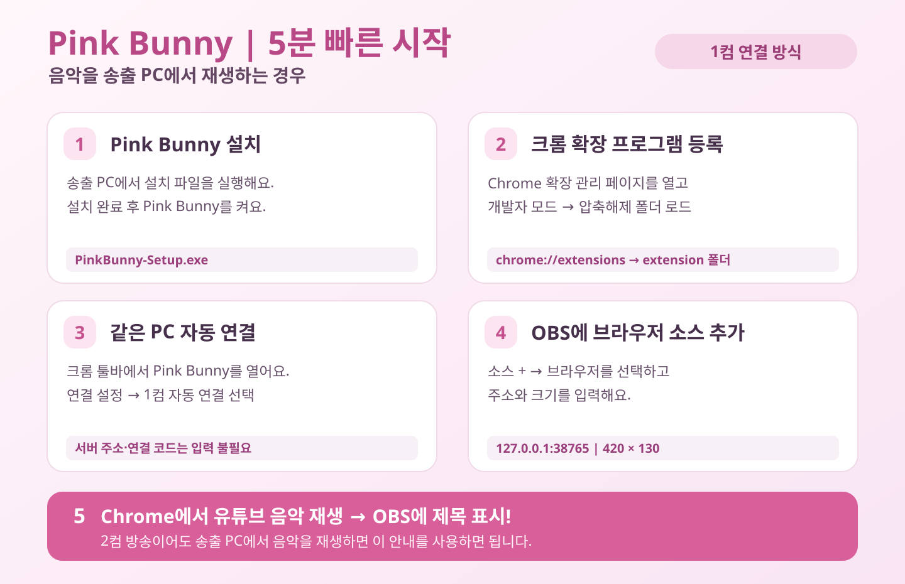

#### 2. 다른 PC에서 음악 재생 — 2컴 연결

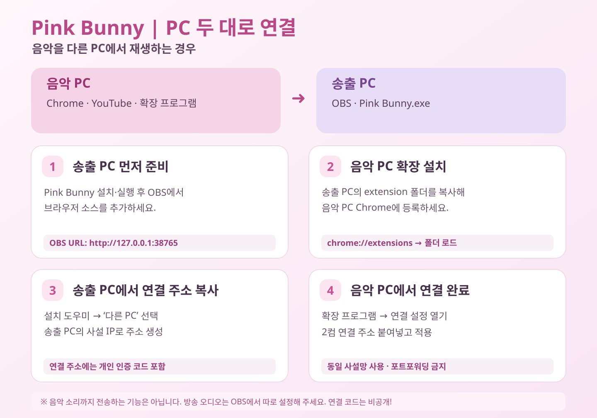

#### 3. Chrome 확장 프로그램 등록

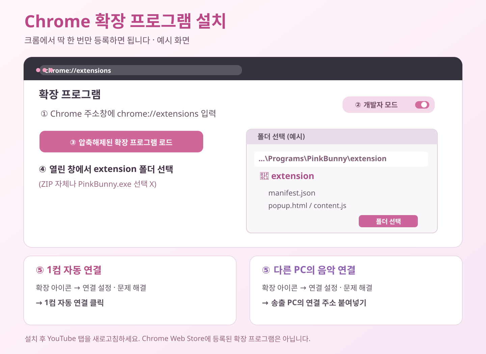

#### 4. OBS 브라우저 소스 추가

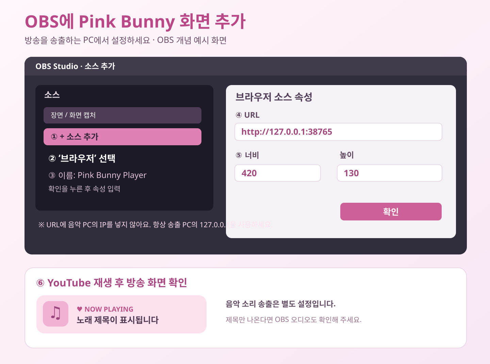

**OBS URL:** `http://127.0.0.1:38765` · **너비:** `420` · **높이:** `130`

---

## Features

### ✨ 기능 사용 그림 (총 7장)

설치를 마쳤다면 아래에서 필요한 기능을 골라 이미지 순서대로 따라 하세요. 그림 속 버튼은 이해를 돕기 위한 UI 예시이며, **실제 버튼 명칭과 제한 사항은 아래 설명**을 참고하세요.

#### 1. Chrome 확장 프로그램 기본 사용

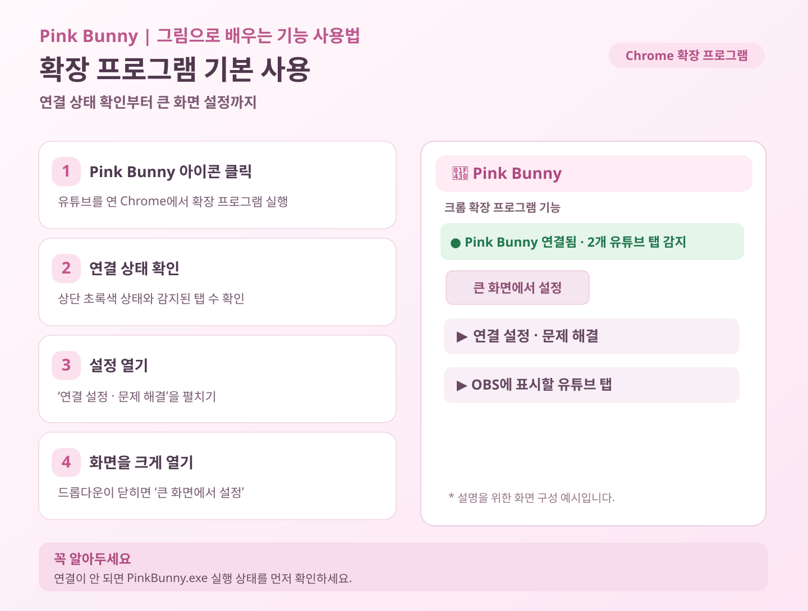

Chrome에서 Pink Bunny 확장 프로그램 아이콘을 클릭하고 연결 상태를 확인하세요. 드롭다운을 조작할 때 창이 닫힌다면 **큰 화면에서 설정**을 사용하면 됩니다.

#### 2. OBS에 표시할 유튜브 탭 고정·숨기기

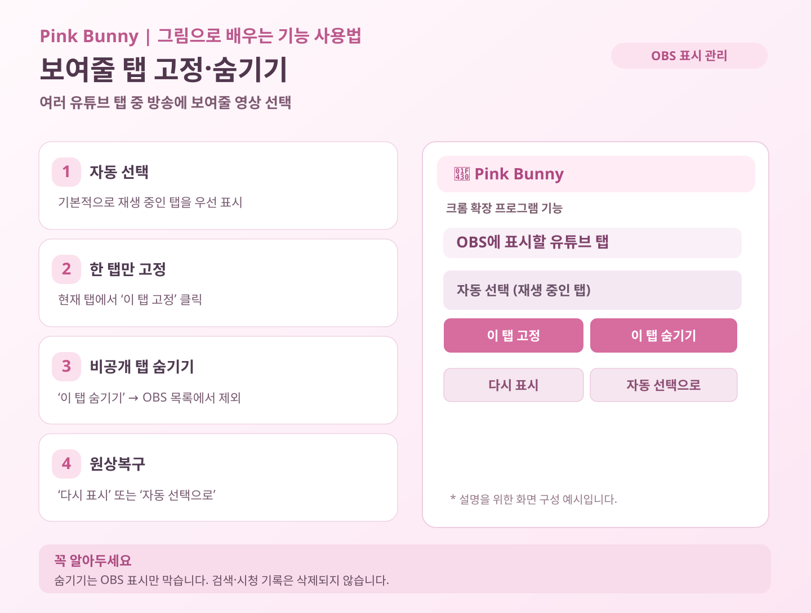

방송에 보여줄 탭을 고정하거나, 특정 탭의 **OBS 표시만** 숨길 수 있습니다. 숨김은 Chrome 방문 기록을 삭제하지 않습니다.

#### 3. 재생·일시정지·음량·이전/다음 영상 제어

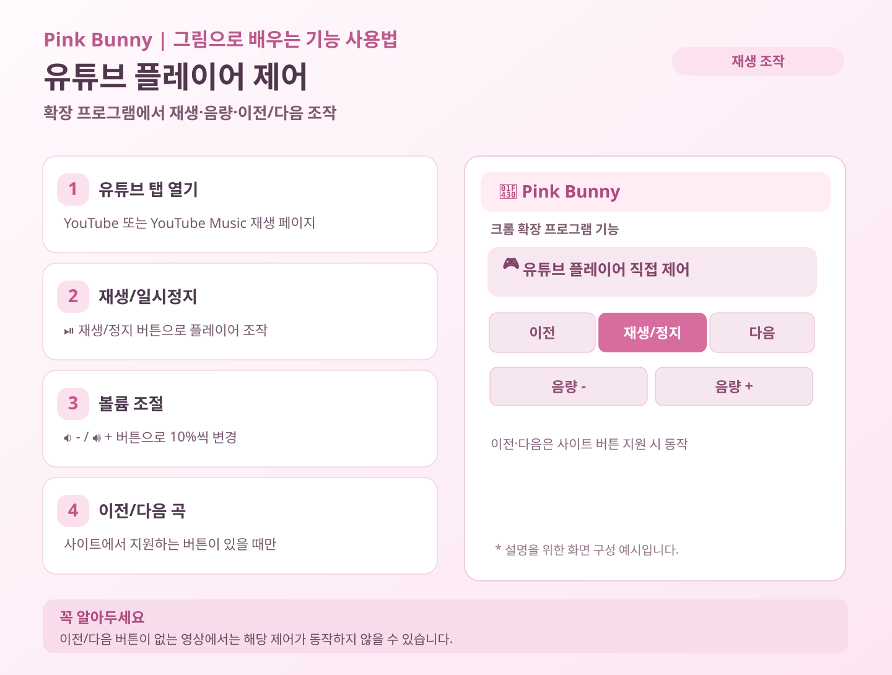

재생/일시정지와 **유튜브 영상 자체 음량**을 조절할 수 있습니다(OBS·Windows 음량은 별도). **이전·다음 버튼**은 사이트에 해당 버튼이 있는 경우에만 동작합니다. 반응이 없다면 버튼 바로 아래 오류 메시지를 확인하고 Chrome 확장 프로그램과 유튜브 탭을 새로고침하세요.

#### 4. 디자인 테마·레이아웃·캐릭터 꾸미기

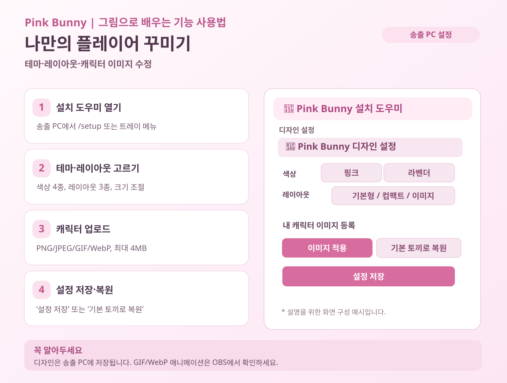

송출 PC 설치 도우미에서 4가지 테마, 레이아웃, 크기와 사용자 이미지(PNG/JPEG/GIF/WebP)를 설정할 수 있습니다. 사용자 이미지 파일 제한은 **4MB, 각 변 2048px 이하**입니다.

#### 5. 1컴·2컴 연결과 음악 원격 제어

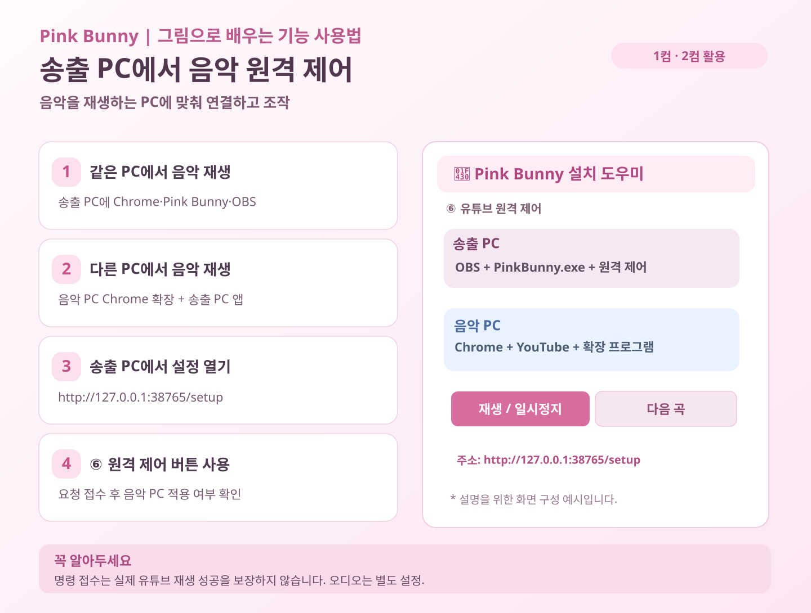

음악 PC가 다른 경우에는 송출 PC와 같은 사설망으로 연결합니다. 송출 PC에서 원격 제어 요청 후 **Chrome 명령 처리 성공·실패·시간 초과**를 확인할 수 있습니다. 단, 성공 응답은 실제 OBS 오디오 송출까지 보장하지 않습니다.

#### 6. 광고·Shorts 스마트 방송 필터

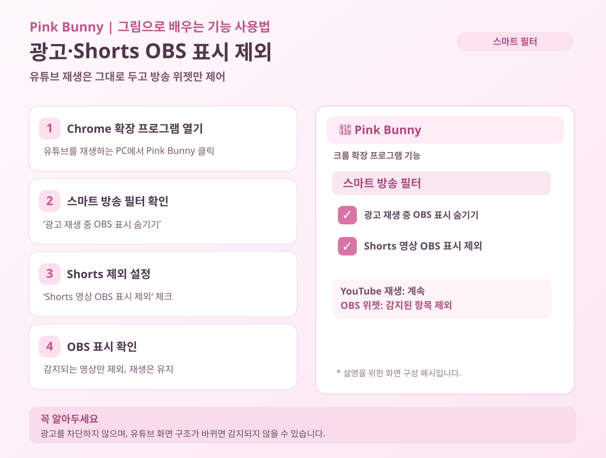

감지되는 광고 재생 정보와 Shorts를 **OBS 표시 대상에서 제외**합니다. **유튜브 광고를 차단하는 기능은 아닙니다.**

#### 7. 연결 실패·OBS 화면·소리 문제 해결

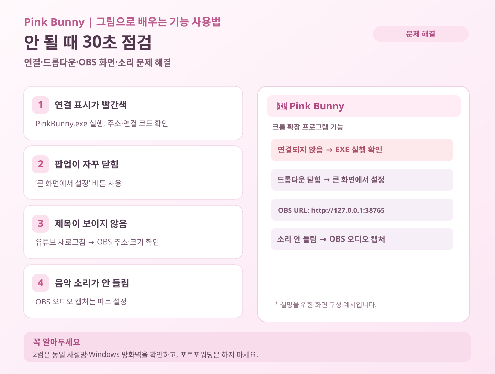

Pink Bunny 실행, Chrome 확장 연결, 유튜브 새로고침, OBS 브라우저 소스 URL을 먼저 확인하세요. **음악 소리**는 Pink Bunny가 전송하지 않으므로 OBS 오디오 캡처를 별도로 설정해야 합니다.

---

### 🖥️ 설치한 PC 안에서는 더 편하게 볼 수 있어요

설치 프로그램을 사용했다면 **시작 메뉴 → Pink Bunny 그림 설치 가이드**, ZIP을 사용했다면 압축을 푼 `guide/index.html`을 여세요. 이 방법으로는 **버튼을 눌러 설치 방식과 기능을 선택하는 인터랙티브 안내서**를 볼 수 있습니다.

Pink Bunny 실행 중에는 **송출 PC에서** `http://127.0.0.1:38765/guide`를 열어도 됩니다. 이 주소는 **프로그램이 실행 중인 컴퓨터 전용**입니다. 위의 GitHub 그림 페이지는 프로그램을 설치하지 않아도 열 수 있습니다.

> Pink Bunny는 Windows용 무료 **베타** 프로그램입니다. 실제 YouTube/YouTube Music·Chrome·OBS 버전에 따라 일부 기능이 다르게 동작할 수 있습니다. 방송에 사용할 음악은 저작권 및 플랫폼 정책을 확인해 주세요.
