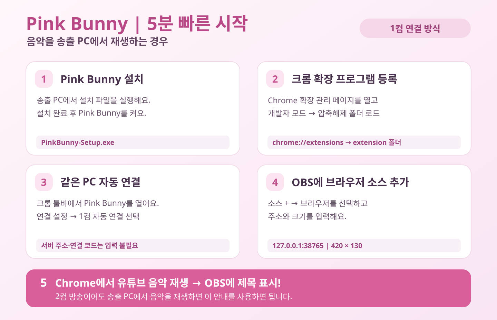

# 🐰 Pink Bunny · OBS용 유튜브 음악 정보 위젯

**Windows 무료 베타 · v12.0.0 · 회원가입 불필요**

Pink Bunny는 Chrome에서 재생하는 **YouTube / YouTube Music 영상의 제목·채널·썸네일·재생 시간**을 OBS 브라우저 소스에 표시하는 프로그램입니다. **음악 소리를 송출하거나 음원을 분석하는 프로그램은 아닙니다.**

**[📥 최신 Windows 설치 파일 다운로드](https://github.com/Cho-L/PinkBunny/releases/tag/beta)** · [📘 설치 그림 안내](GUIDE.md#install) · [✨ 기능 사용 그림 7장](GUIDE.md#features) · [📰 게시글용 소개](POST_KO.md)

## 🎵 핵심 기능

| 분야 | 기능 | 참고 |
| --- | --- | --- |
| OBS 자동 표시 | 유튜브 영상 제목, 채널명, 썸네일, 재생 시간·진행바 | 영상 정보가 읽히는 경우에 표시 |
| 방송 화면 꾸미기 | 4색 테마, 레이아웃 3종, 크기·불투명도, 캐릭터 이미지 | PNG/JPG/GIF/WebP, 최대 4MB |
| Chrome 확장 프로그램 | 재생·일시정지, 음량 조절, 탭 고정·숨김, 이전·다음 영상 | 이전·다음은 유튜브 버튼이 있는 경우에 한함 |
| 방송 보조 | 감지된 광고·Shorts **OBS 표시 제외**, 다음 곡 미리보기, 곡 변경 연출 | 광고 차단 기능이 아님. 다음 곡은 확인 가능한 목록에서만 표시 |
| 1컴 / 2컴 | 같은 PC 자동 연결, 사설망 2컴 연결, **명령 실행 응답** 표시 | 음악 PC Chrome의 명령 처리 응답이며 실제 방송 오디오/OBS 변화의 확인은 별도 |
| 방송 준비 진단 | 서버 실행·Chrome 확장 통신·유튜브 영상 데이터 최근 수신 여부 자동 점검 | OBS 브라우저 소스와 오디오 연결은 수동 확인으로 표시 |

다음 곡 미리보기와 광고 감지는 YouTube/YouTube Music의 화면 구조에 의존하므로 일부 영상이나 재생 상황에서는 제공되지 않을 수 있습니다. 최신 통합 환경 검증이 완료된 정식 버전은 아닙니다.

## 🚀 처음 설치하는 방법

**먼저 유튜브를 어느 PC에서 재생하는지 확인하세요.** 방송이 2컴이어도 **송출 PC에서 음악을 재생하면 아래 '같은 PC' 방식**을 사용합니다.

1. **송출 PC**에 `PinkBunny-Setup.exe`를 설치하고 Pink Bunny를 실행합니다. 설치 도우미가 자동으로 열립니다.
2. **유튜브를 재생하는 PC의 Chrome**에서 `chrome://extensions`를 열고 개발자 모드를 켭니다. **압축해제된 확장 프로그램을 로드합니다**를 눌러 설치된 `extension` 폴더를 선택합니다.
3. Chrome 툴바의 **Pink Bunny**를 열고 **연결 설정 · 문제 해결**을 펼칩니다.
   - **같은 PC에서 음악 재생:** `1컴 자동 연결`을 누릅니다. 첫 실행 시 자동 연결을 시도하기도 합니다.
   - **다른 PC에서 음악 재생:** 송출 PC 설치 도우미에서 **다른 PC에서 재생** 선택 → 사설 IP 및 연결 주소 복사 → 음악 PC 확장 프로그램의 **2컴 연결 주소 붙여넣기** → **2컴 연결 주소 적용 (권한 허용)**. Chrome이 해당 송출 PC 주소 접근 권한을 요청하면 허용하세요. `extension` 폴더도 음악 PC에 복사해 등록해야 합니다.
4. **송출 PC의 OBS** → 소스 추가 **+** → **브라우저** → URL `http://127.0.0.1:38765`, 너비 **420**, 높이 **130** 입력.
5. Chrome에서 유튜브 페이지를 새로고침하고 재생한 뒤, OBS의 제목·진행바 표시를 확인합니다.

설치 도우미가 열리지 않으면 송출 PC에서 `http://127.0.0.1:38765/setup`에 접속하세요. 확장 프로그램 설정이 클릭 중 닫히면 **↗ 큰 화면에서 설정**을 이용하세요.

**참고:** 개발자 모드로 확장 프로그램을 수동 등록하는 방식이며, 현재 Chrome 웹 스토어에서 원클릭 설치하는 방식은 아닙니다.

### ✨ 기능별 그림 사용 가이드

설치가 끝났다면 **[기능별 그림 가이드 7장 보기](GUIDE.md#features)**를 열어 보세요. 설치 도우미 및 Chrome 확장 프로그램에도 **그림 사용법 버튼**이 추가되었습니다.

- [Chrome 확장 프로그램 기본 조작](overlay/guide-feature-extension.svg)
- [OBS 표시 탭 고정·숨김](overlay/guide-feature-tabs.svg)
- [영상 재생 제어](overlay/guide-feature-controls.svg)
- [디자인·캐릭터 꾸미기](overlay/guide-feature-design.svg)
- [1컴·2컴 원격 제어](overlay/guide-feature-remote.svg)
- [광고·Shorts 스마트 필터](overlay/guide-feature-filters.svg)
- [연결·OBS·오디오 문제 해결](overlay/guide-feature-troubleshoot.svg)

자세한 주의사항과 기능별 순서는 **[한국어 기능 사용 설명서](FEATURE_GUIDE_KO.md)**를 참고하세요. 그림은 이해를 돕는 UI 예시이며 실제 화면 캡처가 아닙니다.

### 🖼️ 그림으로 따라 하는 설치

**[📘 설치 이미지 4장 한 번에 보기](GUIDE.md#install)**

- [같은 송출 PC에서 유튜브 재생](overlay/guide-quickstart-1pc.svg)
- [다른 PC에서 유튜브 재생](overlay/guide-quickstart-2pc.svg)
- [Chrome 확장 프로그램 등록](overlay/guide-chrome-extension.svg)
- [OBS 브라우저 소스 추가](overlay/guide-obs-source.svg)

Windows 설치 후 **시작 메뉴 → Pink Bunny 그림 설치 가이드**를 열면 오프라인에서도 볼 수 있습니다. ZIP 사용자는 압축을 푼 `guide/index.html`을 여세요. 그림은 **예시 화면**이며 실제 Chrome·OBS 버전에 따라 메뉴 위치가 다를 수 있습니다.

## 🩺 방송 준비 자동 진단 및 원격 제어 결과 확인

송출 PC에서 Pink Bunny 실행 후 **[설치 도우미](http://127.0.0.1:38765/setup)**를 열면 방송 준비 상태를 자동으로 확인합니다. **Pink Bunny 서버**, **최근 Chrome 확장 프로그램 통신**, **최근 YouTube 영상 정보 수신**을 각각 분리해 표시합니다. Chrome이 열려 있어도 유튜브 페이지에서 정보가 오지 않으면 ‘확인 필요’로 표시되며, 확장 프로그램 자체의 설치 여부를 단정하지 않습니다.

**OBS 소스와 음악 오디오의 실제 연결 상태는 자동으로 확인하지 않습니다.** 두 항목은 ‘수동 점검’으로 표시하고 확인할 설정 위치를 안내합니다. OBS WebSocket 소스 추가 기능은 별도 선택 기능입니다.

같은 페이지의 **⑥ 유튜브 원격 제어**에서 버튼을 누르면 명령의 상태를 **대기·전달·처리 성공/실패·시간 초과**로 확인합니다. 처리 성공은 음악 PC Chrome 콘텐츠 스크립트가 요청을 수락한 결과를 의미하며, 실제 소리가 OBS에 전송됐다는 보장은 아닙니다. 오래된 Chrome 확장 프로그램과 조합하면 응답이 돌아오지 않으므로 최신 확장으로 새로고침하세요.

## ⚙️ 추가 기능·문제 해결

- **디자인 설정:** Pink Bunny 설치 도우미에서 테마·레이아웃·사용자 이미지·미리보기를 조정할 수 있습니다. 이미지는 송출 PC에 저장됩니다.
- **OBS 소스 자동 추가(선택):** 설치 도우미의 OBS WebSocket 기능을 이용합니다. OBS에서 WebSocket 서버를 켜야 하며 환경에 따라 수동 추가가 필요할 수 있습니다.
- **Windows 자동 시작(선택):** 설치 도우미에서 켜거나 끕니다.
- **종료:** 작업 표시줄 알림 영역의 Pink Bunny 아이콘에서 종료합니다.
- **음악 소리가 안 나요:** Pink Bunny는 재생 정보를 표시할 뿐 **오디오를 OBS로 전송하지 않습니다.** OBS 오디오 캡처 설정을 따로 확인하세요.
- **제목이 표시되지 않아요:** Pink Bunny 실행 상태, Chrome 확장 프로그램 연결, 유튜브 탭 새로고침, OBS 소스 URL을 확인하세요.
- **2컴 연결이 안 돼요:** 두 PC의 사설 네트워크 연결과 방화벽, 송출 PC IP·페어링 코드를 확인하세요. 확장 프로그램을 업데이트했다면 **2컴 연결 주소 적용 (권한 허용)**을 다시 눌러 Chrome의 송출 PC 주소 접근 권한을 허용하세요.

## 🔒 베타·보안 안내

- 현재 Chrome, YouTube/YouTube Music 및 OBS 실사용 조합에서 모든 기능이 검증된 것은 아닙니다. [QA 보고서](QA_REPORT.md)를 확인해 주세요.
- 영상 제목·채널·URL·재생 상태는 연결한 Pink Bunny **로컬 서버**로 전송됩니다. 외부 중계 서버는 사용하지 않습니다. v11.3부터 OBS 상태·썸네일·설정·가이드 페이지는 **송출 PC에서만 접근 가능**합니다. 음악 PC는 연결 코드로 보호되는 확장 프로그램 API만 사용할 수 있습니다. 신뢰할 수 있는 **개인 사설망에서만** 사용하고 포트포워딩을 하지 마세요.
- 신규 설치는 128비트(16바이트) 무작위 연결 코드(32자리 16진수)를 사용합니다. 기존 8자리 코드는 업그레이드 시 **기존 2컴 연결을 유지하기 위해 그대로 보존**되므로 새 코드만큼 강하지 않습니다. 2컴 연결 주소에는 코드가 포함되며 공개하면 안 됩니다.
- 확장 프로그램은 기본적으로 로컬 Pink Bunny·YouTube에만 접근합니다. **2컴 연결 시 선택한 송출 PC IP**에 대해서만 Chrome 권한 승인을 요청합니다. 음악 PC에서 ‘그림 사용법’을 누르면 공개 GitHub 그림 안내서가 열립니다.
- 주의: 같은 PC의 악성 프로그램·권한을 가진 다른 확장 프로그램까지 막는 보안 장치는 아니므로 본인이 신뢰하는 PC에서만 사용하세요.
- EXE는 코드 서명이 없어 Windows 보안 경고가 나타날 수 있습니다. 출처를 확인하고 설치하세요.
- 음악을 방송에 사용할 때는 저작권 및 각 플랫폼의 정책을 별도로 확인해 주세요.

## 📚 문서·개발

- [✨ 기능 사용 설명서](FEATURE_GUIDE_KO.md)
- [📢 커뮤니티 게시글용 요약](POST_KO.md)
- [📜 버전별 변경 기록](CHANGELOG.md)
- [🧪 QA 검증 범위](QA_REPORT.md)

개발자용 빌드: `go test ./...` / `go build -o PinkBunny.exe .`

주요 코드는 `main.go`(로컬 서버), `extension/`(Chrome 확장 프로그램), `overlay/`(OBS 위젯)과 `.github/workflows/`(Windows 자동 빌드)에 있습니다.
